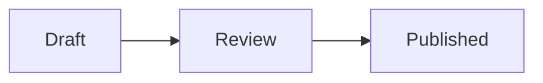
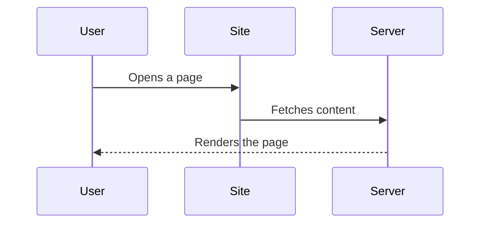
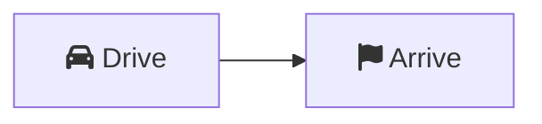

Write a diagram in Mermaid syntax inside a `mermaid` fence and {vars.project.title} renders it as an inline SVG at build time. No JavaScript is needed to display it, and the diagram follows the active light or dark scheme automatically.

````markdown

````


---

## Sequence Diagrams

Every diagram type built into Mermaid 12.1.0 works: flowcharts, sequence diagrams, class diagrams, state diagrams, ER diagrams, pie charts, Gantt charts, git graphs, mindmaps, timelines, and the rest.

````markdown

````


---

## Icons in Labels

FontAwesome icons work inside labels with the `fa:` prefix. They resolve through the same icon packs as the rest of the site, so `fa:fa-car` renders the FontAwesome car.

````markdown

````


---

## Zooming

Every diagram has an expand button at its top-right. It opens the diagram in a popup, where pinch on a phone, Ctrl or Cmd plus scroll on a desktop, or the buttons at the bottom-right enlarge it. On a phone, tapping the diagram itself opens the popup too. Drag to move around an enlarged diagram, double-click to zoom in or reset. A second expand button at the top-right of the popup grows it to fill the screen, and back. On a phone the popup slides up as a sheet from the bottom, and the expand button takes it full screen. The bar at the top of the sheet is a drag handle: pull it up to expand, down to shrink back or close. The zoom code only loads when a popup opens.

---

## What Isn't Supported

ZenUML and other external Mermaid plugins are not supported, and full HTML blocks in labels don't render (simple formatting like bold and line breaks works). A fence with an unsupported diagram type stays a plain code block, with a build warning saying why. A diagram with a syntax error does the same, so a bad diagram never breaks the build.

Math in labels (`$$...$$`) shows the raw TeX source. Typesetting math needs a browser to measure the expressions, and there is no browser at build time.

---

## Theming

Diagrams follow the site's scheme through Pele's CSS variables (`--pele-bg`, `--pele-fg`, `--pele-accent`, and the rest), which the theme maps onto the scheme tokens. Override them in your own CSS to restyle diagrams, for example:

```css
.pele {
  --pele-accent: #e11d48;
}
```

Wide diagrams switch to a vertical layout instead of shrinking to nothing on a phone, and every diagram scales down to fit its container.

---

## Turning Diagrams Off

Set `site.markdown.mermaid` to `false` in `config.yml` and `mermaid` fences stay plain code blocks:

```yaml
site:
  markdown:
    mermaid: false
```
